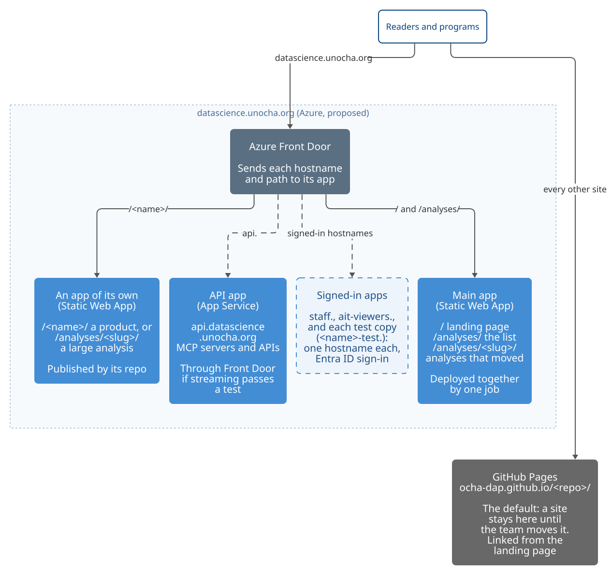

# The team site on datascience.unocha.org

> **Proposed (D126), for the team to review. Nothing is built yet.** Every site stays on GitHub Pages (`ocha-dap.github.io/<repo>/`) by default: it is free and fine for most sites. A site moves to `datascience.unocha.org` only when it needs more reliable availability or access than GitHub Pages gives.

How each site is built stays in [static-data-apps.md](../methods/static-data-apps.md).

Front Door holds the name and its certificate; OCHA's IT team (TSS) keeps the DNS records in the `unocha.org` zone. Static Web Apps use the Standard plan. Diagram source: [datascience-site.d2](datascience-site.d2).

## Addresses

| Address | What is there | App |
|---|---|---|
| `datascience.unocha.org/` | The landing page: lists the team's sites wherever they are | main, `chd-ds-web-main` |
| `/analyses/` | The list of analyses, by topic | main |
| `/analyses/<slug>/` | An analysis that moved. `<slug>` is the repo name without `ds-` | main; its own app if over 100 MB |
| `/<name>/` | A flagship that moved: a product the team keeps up to date for people outside the team, named by hand | its own, `chd-ds-web-<name>` |
| `api.datascience.unocha.org/<name>/mcp` and `/<name>/v1/…` | Public MCP servers and APIs | App Service |
| `ocha-dap.github.io/<repo>/` | Every other site | GitHub Pages |

| Today | If it moved |
|---|---|
| `ocha-dap.github.io/ds-aa-tracking/` | `datascience.unocha.org/aa-tracker/` |
| `ocha-dap.github.io/ds-seas5-skill/app/` | `datascience.unocha.org/seas5-alerts/app/` (as a flagship) |
| `ocha-dap.github.io/ds-aa-ner-drought/app/` | `datascience.unocha.org/analyses/aa-ner-drought/app/` |
| `ocha-dap.github.io/ds-knowledge-base/` | stays (proposed): the team's working reference, deployed many times a day; its hub stays the full index of team sites |

- A repo's products keep their place under its address ([landing-page convention](../methods/static-data-apps.md#one-repo-one-pages-site--the-landing-page-convention)). Topics are labels on the landing page, not part of the address, so an analysis can change topic and keep its address.
- An analysis is not republished on a daily or weekly schedule (monthly is fine), because every deploy replaces the whole main app. Proposed: a scheduled site that needs to move gets an app of its own at an `/analyses/` address.
- Reserved at the root: `analyses`, `apps`, `api`, `mcp`, the flagship names and the landing page's own folders (such as `assets`). A Static Web App also sends `/api` to its own API backend. The list of what is on the site should refuse a name that takes one, or a duplicate (to add).

## The first cut

Nothing moves by default. The first cut, for the team to change, sorts today's 49 public Pages sites by where each would go if it moved (the [full table](#every-repo-and-where-it-would-go) is at the end):

- 4 flagships: the AA tracker, the first candidate to move, and three guesses (SEAS5 precipitation alerts, geospatial impact estimates, storm alerts sign-up). Names are placeholders.
- 23 analyses.
- 20 with no place yet: 9 republished on a schedule, 5 team tools and documentation, 6 behind passwords.
- 2 that could switch Pages off.

## Apps and cost

- **Main app.** An assembly job collects the latest files of every analysis that moved, adds the landing page and the list, and deploys them together. It checks total size and file count on every run, and keeps an analysis at its last good copy if it would pass the limit. 13 of the 23 analyses are served today from a folder in a branch (6 not `main`), which the job copies. The other 10 are built by a workflow, which would also upload the built site to blob storage for the job.
- **An app of its own** is published by its own repo's workflow. An analysis that moves to one keeps its `/analyses/` address, because Front Door's more specific route wins over the main app's catch-all. Any analysis can make that move later (for example if the main app passes about 400 MB).
- **Limits per app** (Standard plan, [quotas](https://learn.microsoft.com/en-us/azure/static-web-apps/quotas)): 500 MB published, 2 GB including preview copies, 15,000 files. If every analysis in the first cut moved, the main app would hold 179 MB in 1,496 files so far, with 10 not measured: about 330 MB if those are like the rest. Every site gets measured before it moves.
- **Price** ([pricing](https://azure.microsoft.com/en-us/pricing/details/app-service/static/)): USD 9 per app per month, whatever its size, and USD 35 a month for Front Door Standard. Traffic: 100 GB a month included per subscription, then USD 0.20 per GB, plus Front Door's traffic charges. About USD 44 a month with nothing moved, 53 with the AA tracker moved, 89 (6 apps) if the whole first cut moved. Most of what a move costs is work: forwarding pages, address checks and password paths (below).
- **Settings on every app.** Front Door passes the path through unchanged, so each app keeps its files under its path (`aa-tracker/`, `analyses/<slug>/`). The main app answers every other address, with its 404 page. `trailingSlash` is `auto`, so `/aa-tracker` redirects to `/aa-tracker/` as on GitHub Pages; it also drops `.html` from addresses with a redirect, which the AA tracker's page-view counter must allow for. `datascience.unocha.org` is an allowed forwarded host, so redirects use the public name. Public apps switch off the built-in sign-in addresses (`/.auth/login/…`). Front Door caching stays off at first; if it is turned on later, each deploy purges its path.

## Moving a site

- **Forwarding pages.** GitHub Pages can't send a real redirect, so each old page of a moved repo gets a small page that sends the reader to the new address. The repo's GitHub Pages then serves only these, and they stay for good: sent alert emails and endorsed framework documents keep the old addresses.
- **Data files that programs read** (JSON, CSV, `llms.txt`) also stay at the old address for a transition period, because a forwarding page breaks a program that expects data. The KB's AA tools take the tracker's address from `KB_AA_TRACKER_BASE`, and the KB's generators that name a moved repo's old address are updated in the same change. Links inside a site to its own full `ocha-dap.github.io` address change to the new one.
- **Services that check the address.** The AA tracker's page-view counter and its proxy accept only `ocha-dap.github.io` today: after a move, counts would drop to zero with no error. Its `llms.txt` writes the old address unless `SITE_URL` is set. The token issuer's allowed callers and the storage's CORS setting name the regional forecasts site and the geospatial impact estimates flood-labels page ([token-issuer.md](token-issuer.md)). GitHub Pages sends `access-control-allow-origin: *` on every file; a Static Web App does so only if configured to.
- **Password pages** stay on GitHub Pages until Entra ID sign-in exists. Six repos stay whole: three password sites, and three with nothing open apart from a landing page. At least six first-cut repos mix open and password pages. Such a repo lists its password paths before it moves: its deploy (or the assembly job) leaves them out, the forwarding pages skip them, and moved pages link to them by their full old address. The table at the end misses some, so the repo's own list is the one that counts.

## Signed-in sites (later)

Once sign-in exists, each signed-in site gets a hostname of its own, because the built-in sign-in of Static Web Apps and App Service runs at `/.auth/` on the root of the host:

- `staff.datascience.unocha.org/<product>/`: pages any UN account may open (sign-in limited to the UN tenant, which needs the team's own Entra registration).
- `tracker.datascience.unocha.org`: the AA tracker's development and admin pages, which keep their passwords on GitHub Pages until then.
- `<neutral-name>.datascience.unocha.org`: one per restricted audience (one Entra group). Every hostname with a certificate appears in public certificate logs, so these names say nothing about the content.
- A server app people sign in to in a browser (a chat assistant, an admin screen) also gets a hostname of its own.

## Staging

- **Public sites use the app's preview copies**: one per open pull request, or a named copy such as `staging`, at no extra cost ([named environments](https://learn.microsoft.com/en-us/azure/static-web-apps/named-environments)). An app has up to 10, within its 2 GB. Anyone with the generated link can open one. A preview takes its configuration from its branch, so preview builds leave out production's lock to Front Door and add `X-Robots-Tag: noindex`. A preview shows one app alone, so links between apps and the slash redirects are not checked there. No staging hostname for now.
- **Signed-in sites use a test copy instead.** Previews are off on their apps: a preview takes its branch's sign-in rules (a branch that changed them would publish without sign-in), shares the production app's Entra registration and can't have a custom domain. Each signed-in app gets a second app with its own Entra registration and group of testers, behind Front Door at a fixed address such as `staff-test.datascience.unocha.org`, for USD 9 a month.
- **The AA tracker** already checks each release on its `dev/` pages, which move to `tracker.` with sign-in. Whether `tracker.` also gets a test copy is open.

## MCP servers and APIs

- One hostname for public endpoints that programs call, `api.datascience.unocha.org`, with the product's name first in the path: its name on the site where it has one (`aa-tracker`), otherwise a short name picked by hand (the KB).
- They run on App Service, because a Static Web App's own API backend is fixed at `/api` and stops a request after 45 seconds, too short for a streamed MCP answer. Front Door sends the hostname to the app if streamed answers pass through it (test 6); if not, the hostname points straight at the app and the address stays the same.
- A hostname of its own keeps the site's 404 page and slash redirects away from programs, and lets the hostname move between Front Door and the app. A page on the site that calls an endpoint from the browser needs CORS headers from the app.
- The address is picked once: connectors, scripts and allow-lists hard-code it. An API keeps its old version answering while callers move to a new one.
- Only public endpoints go here. An endpoint for UN staff or the team gets a hostname of its own, like a signed-in site. A site's own data files, such as the AA tracker's JSON, CSV and `llms.txt`, stay with the site.
- Moving today's MCP server (`chd-ds-kb-mcp`, [mcp-connectors.md](mcp-connectors.md)), in order: a Front Door route and DNS records, with Front Door's host name added to `KB_MCP_ALLOWED_HOSTS` (the server answers an unknown host with a 421); the app answers on both `/mcp` and `/<name>/mcp`; every caller moves (connectors, the KB's MCP staleness check, [USING.md](../docs/USING.md), the team chatbot); last, the app accepts requests only from Front Door.

## Azure names

| Thing | Name |
|---|---|
| Main app | `chd-ds-web-main` |
| A flagship's app | `chd-ds-web-<name>` (`chd-ds-web-aa-tracker`) |
| An analysis's own app | `chd-ds-web-<slug>` (`chd-ds-web-regional-forecasts`) |
| A signed-in app, and its test copy | `chd-ds-web-<hostname label>` and `…-test` (`chd-ds-web-staff`, `chd-ds-web-staff-test`) |
| Front Door profile, and its endpoint (where the DNS record points) | `chd-ds-frontdoor`, `chd-ds` |
| Front Door origin group (the app behind a route) | the app's name |
| Front Door route | `route-<name or slug>`; `route-main` for the catch-all; `route-api-<name>` on `api.` |
| Front Door custom domain | the hostname with hyphens for dots (`datascience-unocha-org`) |
| Tags on every app | `tier` (`public`, `staff` or `restricted`) and `repo` (`ds-aa-tracking`) |

`chd-ds-` follows the team's existing Azure names (`chd-ds-demos`, `chd-ds-token-issuer`), and `web` marks the site's apps apart from App Service apps. An app is named after its address; the `repo` tag records the repo that builds it. The main app takes the catch-all route (`/*`); each other app takes one route with three patterns (`/aa-tracker`, `/aa-tracker/`, `/aa-tracker/*`). Front Door Standard allows 100 routes and 100 origin groups.

Two Static Web Apps exist today. `dsci-monitor`, the old pipelines-status dashboard, has had no deploy workflow since 2026-09-30 and could be deleted. Whether `chd-ds-satellite-impact-viewer` joins the site is its owner's decision.

## Before any site moves

- The team's Azure role can't create Static Web Apps ([static-data-apps.md](../methods/static-data-apps.md)). The main app, the Front Door profile, each later app and each new hostname are requests to OCHA's IT team.
- The pages registry's generator and the hub know only `ocha-dap.github.io` addresses. They have to learn the new ones, and record a moved repo's old pages as forwarding pages.

To test:

1. A flagship app and the main app behind `datascience.unocha.org`: `/aa-tracker` without its last slash, a nested folder without its last slash (`/analyses/aa-ner-drought/app`), and a page ending in `.html`.
2. One analysis on an app of its own at `/analyses/<slug>/` while the main app serves the rest of `/analyses/`, including that analysis's address without its last slash.
3. A preview copy, built without the Front Door lock and with the noindex header, opens at its own address while production accepts only Front Door.
4. One deploy of the main app by the assembly job, with its size check.
5. A deploy shows at once through Front Door.
6. An MCP server behind Front Door on `api.`: a streamed answer, a tool call that sends nothing for over a minute, and an idle open stream are not cut off.
7. A signed-in test copy behind Front Door: sign-in completes, and someone outside its test group is refused.

## Open questions for the team

- **Front Door at the start, or with the first app of its own.** Proposed: at the start, so the set-up is one request, the DNS record never changes and `api.` can use it. Without it, the main app takes the name directly for USD 9 a month until a site needs an app of its own.
- **What makes a site move, and which go first.** Proposed: a site moves when it needs more reliable availability or access, decided site by site, the AA tracker first.
- **Server apps as flagships.** The flood exposure app (Dash, on App Service) could sit at a `/<name>/` address, with Front Door sending that path to its App Service app; the app would have to serve under that path. To decide and test.
- **Scheduled sites that are not flagships**: the AA monitoring sites for Ethiopia, Haiti, Nigeria and Somalia, Google Flood Hub, the CERF supplement review and the three mirror explorers. Proposed: they stay on GitHub Pages, linked from the landing page or the AA tracker, and one that needs to move gets an app of its own under `/analyses/`.
- **Applications and analyses: sort by upkeep instead?** Applications would be the sites with a running publish schedule: 13 today, the 4 flagships and the 9 scheduled sites. Analyses have none (16 of the 23 had no deploy in 30 days; teleconnections, with 38, is updated by hand as studies are added). Each application that moved would have an app of its own and a top-level name, and "flagship" would become a label on the landing page, so promoting a site would not change its address (the other way, `/apps/<name>/`, would). Of the 16 AA framework repos, 10 would be analyses, 4 applications and 2 stay behind passwords. It changes the rule and the addresses, not the cost. The first cut is not re-sorted.
- **The knowledge base**: stays on GitHub Pages with its hub (proposed), or moves to `/knowledge-base/`.
- **The folder name**: `/analyses/` (proposed) or `/projects/`, since a repo's site often mixes reports, apps and monitoring pages.
- **Where the list of what is on the site lives**, with the landing page and the assembly job: a small site repo (proposed), so what goes public is one reviewed change, or the KB, next to the pages registry.
- **Hostname labels**: `staff`, `tracker` and `api`, and `-test` for test copies.
- **Switching Pages off** for the superseded pipeline status page and `ocha-lens` (Pages serves a package's branch there).

## Every repo, and where it would go

Snapshot of 2026-11-20 for the 49 public repos in the [pages registry](pages-registry.md), which stays the record of what is published where. 48 answer at their root (`ocha-lens` returns 404). Seven more team repos have Pages on (five private, two old `pa-` repos) and are not in this plan yet.

- **Publish schedule:** a cron workflow in the repo that publishes Pages, or "by another job" when the site was deployed nearly every day of the last 30 without one.
- **Deploys:** every Pages deploy in the last 30 days, including ones made while a site was being built (100+ means at least 100).
- **Size:** the files in the Pages source folder, or the last kept build (compressed, marked "build"). 15 repos are not measured.
- **Password pages:** declared in the pages registry, or found on 2026-11-20 by fetching each page and looking for a password field.

All 49 repos: first cut, address if it moves, app, publish schedule, size, password pages

| Repo | First cut | Address if it moves | App | Publish schedule | Deploys, 30 days | Size | Password pages | Note |
|---|---|---|---|---|---|---|---|---|
| `ds-aa-tracking` | Flagship | `/aa-tracker/` | `chd-ds-web-aa-tracker` | daily | 100+ | 8.4 MB | `admin/`, `dev/` | Open site only (8.4 MB); dev/ and admin/ have passwords and stay on GitHub Pages |
| `ds-geospatial-impact-estimates` | Flagship (guess) | `/impact-estimates/` | `chd-ds-web-impact-estimates` | daily | 27 | not measured | `brief/`, `experimental/`, `manuscript/`, `story-v2/`, `story-v3/`, `story/` |  |
| `ds-seas5-skill` | Flagship (guess) | `/seas5-alerts/` | `chd-ds-web-seas5-alerts` | monthly | 7 | not measured |  |  |
| `ds-storms-alerts` | Flagship (guess) | `/storm-alerts/` | `chd-ds-web-storm-alerts` |  | 3 | 16.1 MB |  |  |
| `ds-aa-bfa-drought` | Analysis | `/analyses/aa-bfa-drought/` | `chd-ds-web-main` |  | 9 | not measured | `hnrp-2027/` |  |
| `ds-aa-bfa-flooding` | Analysis | `/analyses/aa-bfa-flooding/` | `chd-ds-web-main` |  | 0 | 0.6 MB |  |  |
| `ds-aa-cub-hurricanes` | Analysis | `/analyses/aa-cub-hurricanes/` | `chd-ds-web-main` |  | 0 | 9 MB |  |  |
| `ds-aa-drought-indicators` | Analysis | `/analyses/aa-drought-indicators/` | `chd-ds-web-main` |  | 0 | not measured |  |  |
| `ds-aa-lac-dry-corridor` | Analysis | `/analyses/aa-lac-dry-corridor/` | `chd-ds-web-main` |  | 0 | 78.9 MB | `book/` |  |
| `ds-aa-ner-drought` | Analysis | `/analyses/aa-ner-drought/` | `chd-ds-web-main` |  | 0 | 32.9 MB |  |  |
| `ds-aa-npl-flooding` | Analysis | `/analyses/aa-npl-flooding/` | `chd-ds-web-main` |  | 0 | 3.9 MB |  |  |
| `ds-aa-tcd-drought` | Analysis | `/analyses/aa-tcd-drought/` | `chd-ds-web-main` |  | 4 | 7.6 MB | `evaluation_villages_2026/`, `w3_resultat_2026/` |  |
| `ds-aa-uga-flooding` | Analysis | `/analyses/aa-uga-flooding/` | `chd-ds-web-main` |  | 0 | not measured | `partner/`, `triggers/` |  |
| `ds-aa-vut-cyclones` | Analysis | `/analyses/aa-vut-cyclones/` | `chd-ds-web-main` |  | 1 | 1.6 MB |  |  |
| `ds-afro-cholera` | Analysis | `/analyses/afro-cholera/` | `chd-ds-web-main` |  | 0 | 7.2 MB |  | Its daily workflow is switched off (GitHub disabled it for inactivity); turned back on, it needs an app of its own |
| `ds-asap-trends` | Analysis | `/analyses/asap-trends/` | `chd-ds-web-main` | monthly | 0 | not measured |  | Its monthly workflow is switched off (GitHub disabled it for inactivity) |
| `ds-c3s-viz` | Analysis | `/analyses/c3s-viz/` | `chd-ds-web-main` |  | 0 | under 0.1 MB |  |  |
| `ds-eri-drought` | Analysis | `/analyses/eri-drought/` | `chd-ds-web-main` |  | 0 | not measured |  |  |
| `ds-flood-gfm` | Analysis | `/analyses/flood-gfm/` | `chd-ds-web-main` |  | 1 | 13.4 MB |  |  |
| `ds-fts` | Analysis | `/analyses/fts/` | `chd-ds-web-main` |  | 0 | not measured |  |  |
| `ds-geospatial-impact-exposure` | Analysis | `/analyses/geospatial-impact-exposure/` | `chd-ds-web-main` |  | 0 | not measured |  |  |
| `ds-onegms-public` | Analysis | `/analyses/onegms-public/` | `chd-ds-web-main` |  | 0 | 0.1 MB |  |  |
| `pa-aa-fji-storms` | Analysis | `/analyses/pa-aa-fji-storms/` | `chd-ds-web-main` |  | 0 | 23.5 MB |  |  |
| `ds-precip-intercomparison` | Analysis | `/analyses/precip-intercomparison/` | `chd-ds-web-main` |  | 2 | not measured |  |  |
| `ds-regional-forecasts` | Analysis | `/analyses/regional-forecasts/` | `chd-ds-web-regional-forecasts` |  | 0 | 144.1 MB |  | An app of its own for its size (144 MB), at the same address |
| `ds-storm-impact-harmonisation` | Analysis | `/analyses/storm-impact-harmonisation/` | `chd-ds-web-main` |  | 1 | not measured |  |  |
| `ds-teleconnections` | Analysis | `/analyses/teleconnections/` | `chd-ds-web-main` |  | 38 | not measured |  | 38 of the analyses' 56 deploys in 30 days; each would redeploy the main app. Could have an app of its own |
| `ds-aa-caf-flooding` | No place in the first cut |  |  |  | 0 | 8 MB | whole site | Password site |
| `ds-aa-eth-flooding` | No place in the first cut |  |  | daily, by another job | 67 | 0.3 MB |  | Republished on a schedule, not a flagship |
| `ds-aa-hti-hurricanes` | No place in the first cut |  |  | 4 times a day | 47 | not measured |  | Republished on a schedule, not a flagship |
| `ds-aa-mli-drought` | No place in the first cut |  |  |  | 6 | 0.2 MB (build) | `trigger-review/` | Only its landing page is open |
| `ds-aa-nga-flooding` | No place in the first cut |  |  | twice a day | 65 | 34.4 MB (build) |  | Republished on a schedule, not a flagship |
| `ds-aa-som-floods` | No place in the first cut |  |  | daily | 40 | 22.9 MB (build) |  | Republished on a schedule, not a flagship |
| `ds-acled-trends` | No place in the first cut |  |  |  | 0 | not measured | whole site | Password site |
| `ds-cerf-supplement` | No place in the first cut |  |  | daily | 63 | under 0.1 MB (build) |  | Republished on a schedule, not a flagship |
| `ds-external-aa-frameworks` | No place in the first cut |  |  |  | 0 | 2.2 MB | whole site | Password site |
| `ds-fewsnet-mirror` | No place in the first cut |  |  | daily | 31 | 4.9 MB (build) |  | Republished on a schedule, not a flagship |
| `ds-google-flood-hub` | No place in the first cut |  |  | daily | 31 | under 0.1 MB (build) |  | Republished on a schedule, not a flagship |
| `ds-heat-exposure` | No place in the first cut |  |  | daily | 25 | 7.8 MB (build) | `dashboard/` | Only its landing page is open |
| `ds-hnrp-mirror` | No place in the first cut |  |  | daily | 31 | 9.1 MB (build) |  | Republished on a schedule, not a flagship |
| `ds-ipc-mirror` | No place in the first cut |  |  | daily | 31 | 6.8 MB (build) |  | Republished on a schedule, not a flagship |
| `ds-knowledge-base` | No place in the first cut |  |  | daily, by another job | 100+ | 3.1 MB (build) | `systems-map/` | The team's working reference; the landing page links to it |
| `ds-longterm-outlook` | No place in the first cut |  |  |  | 5 | not measured | `outlook/` | Only its landing page is open |
| `ocha-mailchimp` | No place in the first cut |  |  |  | 0 | under 0.1 MB |  | Library documentation |
| `ds-raster-stats` | No place in the first cut |  |  |  | 0 | 5.8 MB |  | Pipeline documentation |
| `ds-rosea-thresholds` | No place in the first cut |  |  |  | 3 | 0.8 MB |  | Internal tool under development |
| `ds-storms-pipeline` | No place in the first cut |  |  |  | 0 | 1.2 MB |  | The pipeline's own dashboard |
| `ocha-lens` | Switch Pages off? |  |  |  | 0 | 56.5 MB |  | Pages serves a Python package's branch root; no page at its root. Switch Pages off? |
| `ds-pipelines-status` | Switch Pages off? |  |  | daily, by another job | 31 | 0.8 MB |  | Superseded by the pipeline registry: switch Pages off? |

